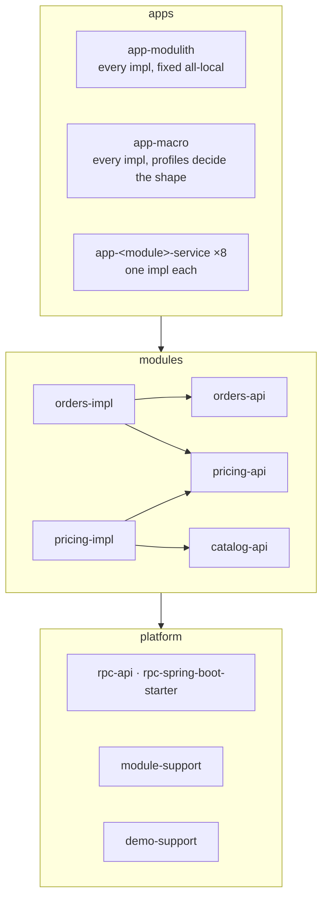
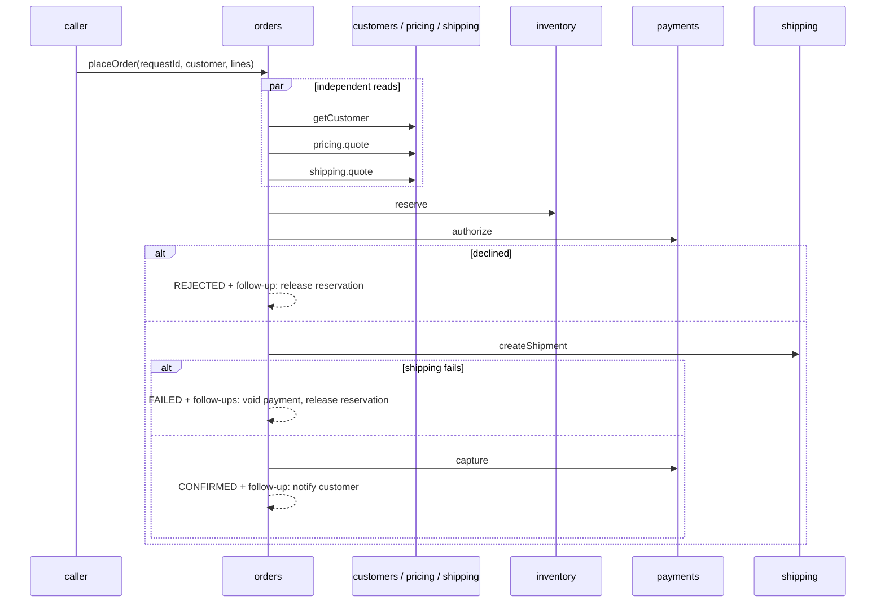

# Architecture

## Modules and assemblies

Every module is two Maven artifacts: `<module>-api` (the `@RpcApi` interface and its data types) and `<module>-impl` (the implementation).
A module may depend only on the `-api` artifacts of the modules it calls. Applications are *assemblies*: they pick which `-impl` jars to
include and which modules to enable.



| Part | What it is |
| --- | --- |
| `platform/rpc-api` | `@RpcApi`, `@Idempotent`, `@Cached`, the `Parallel` helper, the exception hierarchy. No Spring dependency. |
| `platform/rpc-spring-boot-starter` | Server dispatch (`/rpc/<module>`), client proxies, transports, the boundary interceptor, the result cache layer. |
| `platform/module-support` | `@ModuleService`/`@ModuleComponent`/`@ModuleConfiguration` (a bean exists only if its module is enabled), per-module datasource, JPA and Flyway. |
| `platform/demo-support` | Demo profile only: topology, call tracing, fault switches, the shop page. |
| `platform/rpc-docs` | OpenAPI 3.1 and OpenRPC documents generated from the interfaces. |

## One interface, four bindings

A caller injects `PricingApi`. What it receives depends on the module's **binding**:

| Binding | The caller gets | Cost |
| --- | --- | --- |
| `local` | the implementation bean itself | a method call |
| `loopback-codec` | a proxy that serialises the call to JSON-RPC and dispatches it in the same process | encoding and decoding |
| `loopback-http` | a proxy that sends it over HTTP to the same process | a real HTTP round trip |
| `remote` | a proxy that sends it to the URL configured for that module | network |

The default is `local` when the implementation is present and enabled, `remote` otherwise. Configuration is just:

```yaml
modules:
  pricing:
    enabled: false                       # not in this process
    url: http://pricing-host:9183/rpc/pricing
```

JSON-RPC 2.0 is served at `/rpc/<module>`; a convenience alias (`/rpc/<module>/<method>` with bare params) exists for `curl`.
Business exceptions marked `@RpcError(code = …)` cross the wire and are rebuilt as the same exception class on the caller's side, so error
handling is identical in every binding.

## The boundary is enforced, not conventional

* **Maven enforcer** rejects a module that depends on anything other than its allowed `-api` artifacts, and an app whose declared APIs do not
  match its module.
* **ArchUnit** rules reject plain `@Component`/`@Service`/`@Configuration` in module packages and cross-module event use.
* **Spring Modulith** verification rejects module cycles and illegal access.
* **Database roles**: every module has a migration role that owns its schema and a runtime role with DML only on that schema. A module's
  role *cannot read another module's tables*, even when all eight run in one process.

## Persistence: a schema and a connection pool per module

Each module configures its own datasource (`modules.<m>.datasource.*`), JPA `EntityManagerFactory`, transaction manager and Flyway
migrations, in the PostgreSQL schema named after the module. Pools never open a connection at start-up, so an unreachable database does not
stop a process, and a module that is idle holds no connection. In the `split-dbs` mode the groups use three PostgreSQL instances instead of one.

## `orders.placeOrder`: an explicit saga



* Every step is **idempotent** through a request id derived from the order's (`<requestId>:reserve`, `:authorize`, `:ship`, `:capture`), and the
  order's persisted state (`PENDING → RESERVED → AUTHORIZED → CONFIRMED`, or `REJECTED` / `FAILED`) tells a repeated request where to resume.
* Compensations and the confirmation message are **follow-ups**: made durable in the same transaction as the state change, delivered after the
  commit, retried until they succeed. See [follow-up delivery](features/follow-ups.md).
* There is no cross-module transaction. All ordering is explicit in `orders`.

## Seeing what happened

| Aid | What it shows |
| --- | --- |
| `GET /demo/topology` | the modules in that process, their bindings, target URLs, datasource schema |
| `GET /demo/trace?correlationId=…` and `scripts/trace.sh` | every module-to-module call of one order across all processes: caller, callee, method, binding actually used, duration, outcome, depth |
| `POST /demo/faults` | turn a module's failure on or off (notifications down, payments decline, inventory latency) |
| `/swagger-ui`, `/rpc/<module>/openapi.json` | generated API documentation |
| `/shop` | a small web page that drives the demo |

The call trace is also what the [performance tooling](performance/method.md) reads to attribute latency to individual calls.

## Parity risks, and how they are contained

A local call and a remote call differ in ways that can hide bugs: a local call can share a transaction and mutable objects, a remote one cannot.
The **boundary interceptor** makes the local path behave like the remote one where it matters (a caller's transaction is suspended around a
call, calls are observed with the same tags), the same smoke scenarios run in every mode and must give identical results, and a contract test
runs the same scenarios through every binding. The design document lists the remaining differences in section 11.
