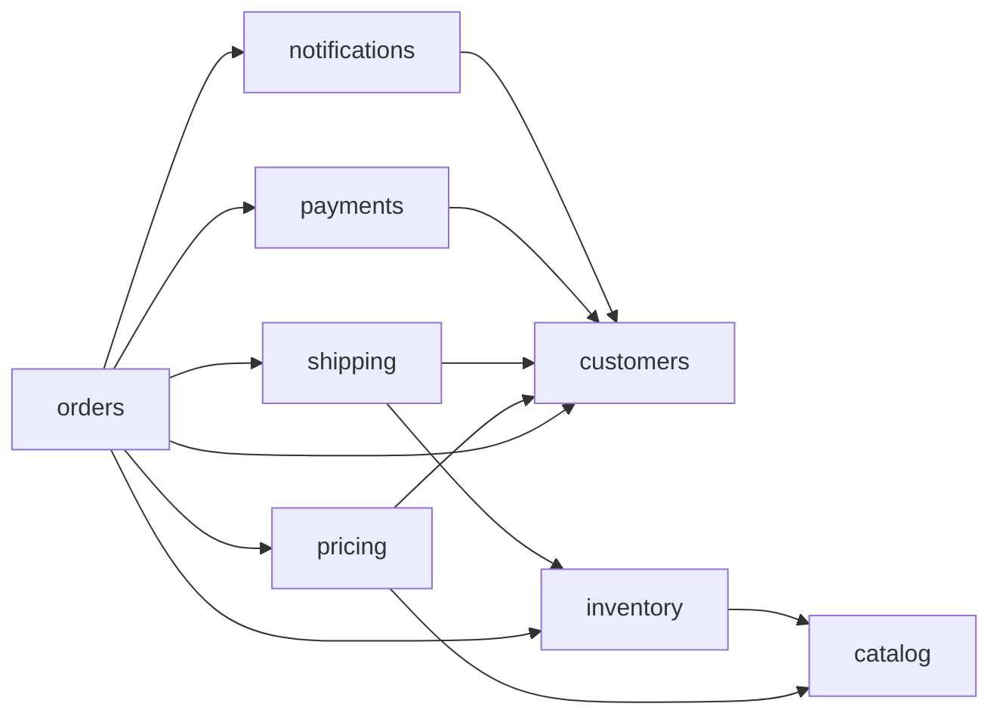

# Macro Service: A Spring Modulith Application Deployable as Monolith or Services

Spring Boot 4 · Java 25 · Spring Modulith · PostgreSQL · JSON-RPC 2.0

## 1. Summary

A macro service is one Spring Boot codebase, built as one image, that runs as a single monolith or as several services depending only on configuration. Modules are Spring Modulith modules with strictly separated APIs. When two modules run in the same process they call each other directly. When they are split, the same Java interface is served and consumed over JSON-RPC 2.0. Each module owns its own PostgreSQL database and schema, on the same instance as other modules or on a different one.

> **JSON-RPC is the only inter-module interaction.** The one way a module talks to another module is a call on that module's `@RpcApi` interface. When both modules are in the same process that call is a direct method call; when they are split it is a JSON-RPC 2.0 request. There is no other channel: no shared database access, no Modulith events, no message broker, no shared in-memory state, and no direct use of another module's internals.

The Java API interface is the single source of truth. Server dispatch, client proxies, OpenAPI and OpenRPC documents are all derived from it.

## 2. Goals, constraints and non-goals

**Goals**

- One repository, one build, one image; the deployment shape is chosen by configuration.
- Module boundaries are enforced at build time (Maven dependency rules, Spring Modulith verification), not by convention.
- A module's `@RpcApi` interface is the only way another module may interact with it. The call is direct in-process and JSON-RPC 2.0 when the target module is not in the same process.
- Each module configures its own PostgreSQL database and schema.
- The Java API interface is the contract; OpenAPI and OpenRPC are generated and never edited by hand.

**Constraints**

- Spring Boot 4, Java 25, Spring Modulith, PostgreSQL.
- No cross-module database access, joins or transactions.
- Module code never knows whether a collaborator is local or remote.
- No channel between modules other than the `@RpcApi` call (see the table below).

| Interaction between modules | Allowed? |
| --- | --- |
| Call another module's `@RpcApi` interface (direct in-process, or JSON-RPC when split) | **Yes, the only way** |
| Use another module's classes outside its `-api` artifact | No (Maven and Modulith verification) |
| Read or write another module's tables or schema | No (separate roles and grants) |
| Publish or listen to another module's Modulith or Spring events | No (ArchUnit rule) |
| Message broker, queue or topic between modules | No |
| Shared in-memory state, static singletons, shared caches | No |
| Shared transaction across modules | No |

**Non-goals**

- Cross-module Modulith events, a message broker, or any asynchronous channel between modules.
- Distributed transactions or two-phase commit.
- Independent per-module versioning: every deployment runs from the same commit.

## 3. Architecture overview

```
+--------------------------------------------------------------+
| One repo, one image: every module is built together          |
|   [ orders ]      [ inventory ]      [ platform ]            |
+------------------------------+-------------------------------+
                               | configuration selects the shape
              +----------------+-----------------+
              v                                  v
+---------------------------+      +-------------------------------+
| Monolith: one process     |      | Split: one process per service|
| [orders] -direct-> [inv.] |      | [orders] -JSON-RPC-> [inv.]   |
+---------------------------+      +-------------------------------+
```

The arrow between orders and inventory is the only interaction between the two modules in either shape. In the monolith profile, orders calls inventory as a direct in-process bean. In a split profile, the inventory bean is replaced by a JSON-RPC client proxy that talks to the inventory service. The module code does not change.

## 4. Repository and module layout

Each business module is split into an `-api` artifact and an `-impl` artifact in one multi-module Maven build. Only the `-api` artifact may be depended on by other modules.

```
repo/
  platform/
    rpc-api/                    @RpcApi, RpcException hierarchy (no Spring dependency)
    rpc-spring-boot-starter/    server dispatcher, client proxies, registrar, spec generator
    module-support/             per-module DataSource, Flyway, EMF helpers, @Module* stereotypes
  modules/
    orders/orders-api/          interface, record DTOs, exceptions
    orders/orders-impl/         implementation, persistence, module configuration
    inventory/inventory-api/
    inventory/inventory-impl/
  app/                          the macro service: Application class, profiles, all impls on the classpath
```

| Artifact | May depend on | Contains |
| --- | --- | --- |
| `<m>-api` | `rpc-api`, JDK; `spring-modulith-api` and `swagger-annotations-jakarta` at `provided` scope (annotations only, for `@NamedInterface` and `@Operation`/`@Schema`) | `@RpcApi` interfaces, immutable records, unchecked exceptions |
| `<m>-impl` | own `<m>-api`, other modules' `-api`, `module-support`, Spring | services, repositories, migrations, `@ModuleConfiguration` classes |
| `app` | all `-impl` artifacts, `rpc-spring-boot-starter` | `@SpringBootApplication` at the root package, profile configs, health and readiness wiring |

Because `-impl` artifacts depend only on other modules' `-api` artifacts, Maven rejects any attempt to reach another module's internals.

### 4.1 Packaging options

The module code is identical in every option. Only the assembly differs, so you can start with A and move to B or C later without touching the modules.

| Option | What you build | What differs per deployment | Choose it when |
| --- | --- | --- | --- |
| **A. One image, config-selected** (the macro service) | One app containing every `-impl` | `modules.<name>.enabled`, datasource and client URLs | You want the simplest pipeline, and image size and a union classpath do not matter |
| **B. Per-service assembly apps, same repo** | One app per service, each with only its own `-impl` plus other modules' `-api` | Which jars are present, plus datasource and client URLs | You want smaller images, or a guarantee that a service cannot run a module it should not |
| **C. Separate repositories and builds** | Each module builds and releases on its own and publishes its `-api` artifact for consumers | Everything | Teams need independent release cadences |

- **A and B** stay in one repository with lockstep versions: every artifact comes from the same commit, and an API change breaks every consumer's build immediately.
- **C** gives up lockstep. Consumers depend on a published `-api` version, so the module owner must keep `-api` changes backward compatible across released versions (section 12, API compatibility check), as in any microservices setup.
- In B and C, the startup validator and the registrar work unchanged: a module whose `-impl` jar is absent has no local bean, so its client proxy is registered and its URL is required.

## 5. Spring Modulith conventions

Modulith treats each direct sub-package of the application's root package as a module. It scans the classpath, so modules from separate Maven jars work as long as they share the root package (`com.acme.orders`, `com.acme.inventory`).

- **Named interface for the API.** The `api` sub-package of each module is exposed with `@NamedInterface("api")`; everything else (`internal`) is hidden.
- **Declared dependencies.** Each module lists what it may use, for example `@ApplicationModule(allowedDependencies = "inventory::api")`.
- **Verification in CI.** `ApplicationModules.of(Application.class).verify()` fails the build on cycles, undeclared dependencies and access to non-exposed types.
- **`@RpcApi` is the only cross-module dependency.** `allowedDependencies` may name only `<module>::api`, and an ArchUnit rule fails the build if any method annotated `@ApplicationModuleListener`, `@EventListener` or `@TransactionalEventListener` takes a parameter type that belongs to another module, or if an event type appears in a `-api` artifact. Cross-module use of anything other than an `@RpcApi` interface and its DTOs and exceptions is a build failure.
- **Documentation.** `Documenter` generates the module canvas and component diagrams from the same model.

```java
// inventory-api: com/acme/inventory/api/package-info.java
@NamedInterface("api")
package com.acme.inventory.api;

// orders-impl: com/acme/orders/package-info.java
@ApplicationModule(allowedDependencies = "inventory::api")
package com.acme.orders;
```

Use the Modulith release line that matches Spring Boot 4 (2.x) and confirm it in the BOM before starting.

## 6. Module enablement

Because the image contains every module, Boot's component scan would register all of them. Enablement therefore has to be a property of the bean itself, not of an outer configuration class.

Module code uses module-aware stereotypes in place of `@Service`, `@Component` and `@Configuration`:

```java
@Target(TYPE) @Retention(RUNTIME)
@Service
@Conditional(ModuleEnabledCondition.class)
public @interface ModuleService {
    String module();
}

class ModuleEnabledCondition implements Condition {
    public boolean matches(ConditionContext ctx, AnnotatedTypeMetadata md) {
        String module = (String) md.getAnnotationAttributes(ModuleService.class.getName()).get("module");
        return ctx.getEnvironment().getProperty("modules." + module + ".enabled", Boolean.class, false);
    }
}
```

`@ModuleComponent` and `@ModuleConfiguration` follow the same pattern. The persistence configuration (datasource, entity manager factory, repositories, Flyway) is a `@ModuleConfiguration`, so a disabled module has no connection pool, no migrations and no scheduled jobs, and the process never touches its schema.

**Guard rails**

- An ArchUnit rule forbids plain `@Service`, `@Component` and `@Configuration` inside module packages.
- Boot's single-datasource autoconfigurations (`DataSourceAutoConfiguration`, `HibernateJpaAutoConfiguration`, `FlywayAutoConfiguration`, `JpaRepositoriesAutoConfiguration`) are excluded, since each module defines its own.
- A startup validator checks every `@RpcApi` interface: each module must be either enabled with a datasource, or disabled with a client URL. Otherwise the application fails to start, for example with `Module 'inventory' is disabled but modules.inventory.url is not set`.
- Health indicators are registered only for enabled modules.

## 7. Inter-module communication: JSON-RPC is the only channel

Every interaction between two modules is a call on the target module's `@RpcApi` interface. That call is a direct method call inside one process and a JSON-RPC 2.0 request between processes. Nothing else connects modules, and the build and the tests enforce it (sections 5 and 12).

### 7.1 One interface, two bindings

Consumers always inject the `-api` interface and cannot tell whether they received a local bean or a client proxy.

```java
@RpcApi("inventory")
public interface InventoryApi {
    StockLevel getStock(String sku);
    Reservation reserve(ReserveRequest request);   // throws unchecked OutOfStockException
}
```

A `BeanDefinitionRegistryPostProcessor` in `rpc-spring-boot-starter` runs after component scanning and handles every `@RpcApi` interface on the classpath:

- **A local implementation bean exists** (the module is enabled): nothing is registered, and injection yields the direct in-process bean.
- **No local implementation** (the module is disabled): a client proxy bean is registered that speaks JSON-RPC to `modules.<name>.url`. Startup fails if the URL is missing.

```java
for (Class<?> api : findRpcApis()) {
    if (beanFactory.getBeanNamesForType(api, true, false).length == 0) {
        registry.registerBeanDefinition(beanName(api),
            BeanDefinitionBuilder.genericBeanDefinition(api, () -> proxies.create(api)).getBeanDefinition());
    }
}
```

The lookup uses `allowEagerInit=false` so it does not instantiate beans. Client proxies implement a marker interface so the server-side dispatcher never mistakes a proxy for a local implementation.

Rules for `@RpcApi` interfaces: no overloaded method names, immutable record parameters and results, unchecked exceptions only, and no types from outside the `-api` artifact.

### 7.2 No other channel: no events, no broker, no shared data

Modules communicate only through `@RpcApi` calls. A module may still use Spring or Modulith events internally, between its own components, but an event never crosses a module boundary. This removes the broker, the externalization and inbound-adapter configuration, and the event publication registry problem that arises when one registry has to serve several databases.

Where a module would previously have reacted to another module's event, it calls the other module's API instead, or the other module exposes a query that the first module polls.

### 7.3 Work that must survive a callee outage

Request/response means the caller depends on the callee being reachable. When a call must not be lost (for example, "tell inventory to release this reservation"), use a module-local outbox:

- The caller writes an outbox row in its own schema in the same transaction as its business change.
- A scheduled relay in the same module reads pending rows and calls the target `@RpcApi` method.
- Target methods are idempotent, keyed by a request id carried in the call, so redelivery is safe.

This uses only the module's own database and the existing JSON-RPC path. Avoid Modulith's event publication registry for this: it is application-wide (one `JdbcOperations`), which does not fit a database per module.

### 7.4 Binding modes and loopback

Each module a consumer calls has a binding, set per target module with `modules.<name>.binding`. By default a local implementation bean wins; the other modes change what the registrar wires up.

| Binding | Path of a call | Network | Intended use |
| --- | --- | --- | --- |
| `local` (default when the impl is present) | Direct method call on the local bean | None | Production monolith |
| `loopback-codec` | Client proxy and dispatcher in the same JVM, through the JSON codec, no HTTP | None | Dev and test: catches DTOs that do not serialize cleanly (the `rpc.loopback=true` mode) |
| `loopback-http` | Client proxy over HTTP to `127.0.0.1`, even though the impl is present | Loopback interface | Integration tests of the real HTTP path; not a production mode |
| `remote` (default when the impl is absent) | Client proxy over HTTP to `modules.<name>.url` | Real network | Split deployment |

```yaml
modules:
  inventory:
    enabled: true
    binding: loopback-http
    url: http://127.0.0.1:9181/rpc/inventory
```

Rules:

- `loopback-codec` and `loopback-http` register the client proxy even though the implementation is present, so the dispatcher must be able to find the local implementation. For `loopback-http`, `rpc.server.enabled` must be on.
- `loopback-http` adds HTTP overhead and a self-call dependency on the server being up, so use it in tests, not in production.
- Two separate services on one host or in one pod may simply use `http://127.0.0.1:<port>/rpc/<module>` as the `remote` URL. Nothing special is needed.
- When `/rpc` is reached only over loopback, bind the endpoint to `127.0.0.1` (a separate `rpc.server.address` or port) so it is never exposed beyond the host. Service-to-service authentication is then not needed on that hop, but it is still required for any hop that crosses a network.
- Startup validation rejects a `loopback-*` binding in any profile marked as production.

## 8. JSON-RPC protocol design

The protocol is JSON-RPC 2.0 over HTTP, implemented in the starter rather than taken from a library: the specification is small, and Boot 4 moves to Jackson 3 (`tools.jackson`), so check any candidate library for Jackson 3 support before adopting it.

| Aspect | Decision |
| --- | --- |
| Endpoint | `POST /rpc/{module}`, one per module, carrying the JSON-RPC envelope; batches and notifications supported |
| Method name | `<module>.<method>`, for example `inventory.reserve`; overloads rejected at startup |
| Parameters | By name (an object keyed by parameter name, compiled with `-parameters`), which evolves better than positional arrays |
| Results | The record returned by the Java method, serialized with Jackson 3 |
| Errors | Exceptions map to JSON-RPC error codes; the exception classes live in the `-api` artifact and are rehydrated on the client, so callers see the same exception types in both modes |
| Client | A `java.lang.reflect.Proxy` over `RestClient` with the JDK HttpClient; per-module timeouts and retry policy |
| Context | Trace identifiers and the caller's principal propagated in HTTP headers |
| Security | mTLS or signed service tokens between services; `/rpc` endpoints are not exposed publicly |
| Threading | Virtual threads (`spring.threads.virtual.enabled=true`) so blocking remote calls stay cheap |

The server side collects all local beans that implement an `@RpcApi` interface (excluding client proxies), builds a `module.method` index, and dispatches by reflection or method handles. The server can be switched off per deployment with `rpc.server.enabled`.

## 9. Persistence: database and schema per module

Each module owns its persistence configuration, bound to `modules.<name>.datasource.*`. A module with no explicit URL falls back to the shared `spring.datasource`, which gives "same instance, different schema" without extra settings.

- **Beans per module.** A `DataSource`, `EntityManagerFactory` (or `JdbcClient`) and `PlatformTransactionManager`, each with an explicit bean name and none marked `@Primary`.
- **Repositories.** `@EnableJpaRepositories(basePackages = "...orders.internal", entityManagerFactoryRef = "ordersEmf", transactionManagerRef = "ordersTm")`, with `@Transactional("ordersTm")` on service code.
- **Migrations.** A manually defined `Flyway` bean per module with its own `locations` (`classpath:db/migration/orders`), `defaultSchema` and history table inside the module's schema.
- **Schema and roles in PostgreSQL.** One schema per module and one role per module with grants only on that schema; set the search path on the role (`ALTER ROLE orders_app SET search_path = orders`). Cross-schema joins then fail instead of creeping in.
- **Migration vs runtime roles.** A migration role with DDL rights for Flyway, and a runtime role with DML only.
- **Connection pools (no external pooler).** The design does not depend on PgBouncer or any other connection pooler, because AWS deployments cannot use one. Connections go straight from each application's pools to PostgreSQL, so the connection budget has to be managed by the application. See 9.1.

No module reads or writes another module's tables. Data owned by another module is obtained through its `-api` interface.

### 9.1 Connection budget without a pooler

This section matters for real AWS deployments. For the local demonstration (section 16) the pools can stay at their small defaults and the budget check can be left at warning level.

Each enabled module has its own Hikari pool, because each module uses its own role (and often its own instance). Different roles cannot share connections, so total connections grow with the number of enabled modules and with the number of application instances.

**The budget**

For each PostgreSQL instance:

`sum over (enabled modules on that instance) of (maxPoolSize x application instances running that module) + migration and admin connections + reserve <= max_connections`

- `max_connections` on RDS and Aurora PostgreSQL is set by the parameter group and by default scales with the instance's memory, so read the real value (`SHOW max_connections`) rather than assuming one. Reserve some connections for superuser, monitoring and failover.
- The same modules in a monolith and in services use the same total per module. The difference is where the pools live: a monolith holds all its module pools in one process, while a service holds only its own module's pool, multiplied by that service's instance count. Scaling a service out multiplies its pool, not the others'.

**Application-level controls**

- **Small pools by default.** Set `modules.<name>.datasource.max-pool-size` per module, starting small and raising it from measured wait times, not from guesses.
- **No idle reservation.** `minimum-idle: 0` (or a low value), a short `idle-timeout` and a `max-lifetime` below any network or database idle limit, so an idle module holds no connections and a quiet service gives its connections back.
- **Lazy startup.** Pools are created only for enabled modules (section 6), and do not fail startup on a slow database when the module is not in use.
- **Concurrency bulkhead.** With virtual threads, thousands of requests can wait on a pool of a few connections. Put a per-module semaphore on the `@RpcApi` server side (and, if you wish, on the client) set equal to or slightly above the pool size, so excess requests queue in the application with a bounded wait and return a clear error rather than exhausting the pool or timing out deep in a transaction.
- **Short transactions.** Never hold a connection across a call to another module; the boundary interceptor in section 11 already suspends the transaction on cross-module calls.
- **Budget check at startup.** Each application reads `platform.db.connection-budget` (the connections this deployment may use on each instance, set per deployment) and logs a warning, or fails when `platform.db.enforce-budget=true`, if its enabled modules' `max-pool-size` values sum above it. The validator cannot know how many replicas run, so the deployment supplies the per-replica share.
- **Metrics.** Expose each pool's active, idle, pending and timeout counts as Micrometer metrics tagged by module, and alert on pending threads and connection-acquire timeouts.

**If the budget is still too tight**

- Use a larger database instance class (more `max_connections`), or move a busy module's schema to its own instance. Per-module datasource configuration already allows this with no code change.
- Reduce the replica count and give each replica a larger pool, if the work is I/O bound on the database rather than the application.
- If AWS RDS Proxy is allowed in your environment (it is a managed AWS service, not PgBouncer), it is an optional, configuration-only addition, because the application treats the database as an ordinary PostgreSQL endpoint. Check its behaviour with prepared statements and session settings such as `search_path`, which can pin connections, before relying on it. The design does not require it.
- Sharing one pool across modules by switching roles on each checkout (`SET ROLE`) is possible but weakens the role-per-module isolation and adds per-checkout overhead, so it is not recommended unless the budget cannot be met any other way.

## 10. Deployment configuration

This section shows packaging option A (section 4.1): the same image is deployed N times with different configuration, selected by a Spring profile or by environment variables such as `MODULES_INVENTORY_ENABLED=false`. With option B or C the configuration is the same, except that a module whose `-impl` jar is absent needs no `enabled: false`, only its client URL. The binding modes in section 7.4 can be set per module in any profile.

```yaml
# application-monolith.yml: every module in one process, separate schemas and instances
modules:
  orders:
    enabled: true
    datasource: { schema: orders }
  inventory:
    enabled: true
    datasource: { url: jdbc:postgresql://db2/inv, schema: inventory }

# application-orders-service.yml: orders locally, inventory over JSON-RPC
modules:
  orders:
    enabled: true
    datasource: { url: jdbc:postgresql://db1/app, schema: orders }
  inventory:
    enabled: false
    url: http://inventory:8080/rpc/inventory

# application-inventory-service.yml: inventory locally, orders is not needed
modules:
  orders:    { enabled: false }
  inventory:
    enabled: true
    datasource: { url: jdbc:postgresql://db2/inv, schema: inventory }
```

| Deployment shape | Enabled modules | Calls between modules |
| --- | --- | --- |
| Monolith | all | direct in-process calls |
| Orders service | orders | `inventory.*` over JSON-RPC |
| Inventory service | inventory | none outbound (or JSON-RPC to others it consumes) |
| Mixed grouping | any subset | in-process inside the group, JSON-RPC across groups |

Startup validation rejects any deployment where a disabled module has no client URL or an enabled module has no datasource, so a misconfigured shape fails fast instead of failing on the first call.

## 11. Local vs remote parity risks

Because the `@RpcApi` call is the only inter-module interaction, it is also the only place where local and remote behaviour can differ. A call that is safe in-process can behave differently over the network, and these differences have to be designed out, because the same module code runs in both modes.

| Risk | Why it differs | Mitigation |
| --- | --- | --- |
| Pass-by-reference vs serialization | Local calls share object references; remote calls copy through JSON | Immutable records for all DTOs; a `rpc.loopback=true` mode for dev and test that routes even local calls through the JSON codec |
| Transactions | A local call may join the caller's transaction on a shared datasource; a remote call never can | No cross-module transactions; the boundary interceptor suspends the caller's transaction on local cross-module calls (`modules.boundary.suspend-transactions`, default `true`; see 17.2); module-local outbox (7.3) for cross-module consistency |
| Failure modes | Remote calls can time out, fail midway or be retried | Idempotent mutating methods (client-supplied request id), timeouts and a retry policy on the client proxy |
| Exceptions | Remote errors pass through an error envelope | Exception types defined in the `-api` artifact and rehydrated on the client |
| Latency | Chatty APIs are cheap in-process and costly over the network | Coarse-grained API methods; no per-row calls in loops |
| Observability | Local calls leave no trace by default | The same boundary interceptor observes local calls as `macro.rpc.client`, tagged exactly like remote calls (17.2) |
| Security context | The principal is implicit in-process | Principal and trace headers propagated explicitly on remote calls |

## 12. Testing strategy

The same test suites protect both deployment models, because the module code is identical in both.

1. **Structure.** `ApplicationModules.verify()` plus the ArchUnit rules (stereotypes, no cross-module event listeners, no cross-module use of anything but `@RpcApi` types). These tests are what guarantee that JSON-RPC-capable calls are the only inter-module interaction.
2. **Module slices.** `@ApplicationModuleTest` bootstraps a single module with its PostgreSQL schema (Testcontainers) and mocks its collaborators' `-api` interfaces, which is the same situation a split deployment creates.
3. **Contract tests.** One test suite per `-api` artifact, run against each binding from section 7.4: `local`, `loopback-codec` (JSON round trip in-process), and `loopback-http` or `remote` against a started server. A failure in one binding but not the others is a parity bug.
4. **API compatibility.** japicmp compares each `-api` artifact with its last released version and fails the build on removed or changed methods, constructors, fields (including record components) and exception types, to keep rolling deployments safe (see 14.3 and 17.2).
5. **Deployment smoke tests.** Start the image with each profile (monolith, each service) and call one method per module through the public API, including one call that crosses a module boundary.
6. **Startup validation tests.** Assert that each broken configuration (missing URL, missing datasource) fails with the expected message.

## 13. API documentation: OpenAPI and OpenRPC

The Java interface is the source of truth, so generated documents cannot drift from the code. JSON-RPC does not map cleanly onto OpenAPI because every call is a `POST` to one URL, so the design uses two complementary outputs.

- **OpenAPI.** Generated at runtime from the `@RpcApi` interfaces. *Implementation note (stage 7):* swagger-core (2.2.55, the latest) and springdoc (3.1.1, which targets Boot 4) both still depend on Jackson 2 (`com.fasterxml.jackson`); no release supports Jackson 3. The record schemas are therefore generated by the `rpc-docs` module itself, following Jackson's record conventions, and the Swagger annotations are read by name. Swagger UI comes from the `org.webjars:swagger-ui` webjar, without springdoc. One operation per method at `POST /rpc/{module}/{method}`.
- **Path alias on the server.** The same `POST /rpc/{module}/{method}` path is also served: bare params object in, bare result out, no envelope. This makes Swagger UI and curl usable, while the real protocol remains the JSON-RPC envelope on `/rpc/{module}`.
- **OpenRPC.** The native description format for JSON-RPC, emitted from the same reflection model; the more faithful document for client generators.
- **Endpoints.** `/rpc/{module}/openapi.json` per module, and a merged document for deployments that run several modules.
- **Descriptions.** Optional `@Schema` and `@Operation` annotations on the API interfaces.

No spec file is committed or edited by hand. If a spec is needed as a build artifact, a build step generates it from the compiled `-api` artifact.

## 14. Development process compared with standard microservices

"Standard microservices" here means each service is an independently built, versioned and released component, usually with its own repository, pipeline and client library for its neighbours.

### 14.1 Side by side

| Concern | Macro service | Standard microservices |
| --- | --- | --- |
| Repository and build | One repository, one multi-module build, one image | A repository (or independent build) per service, N images |
| Local development | Run the monolith profile in one JVM with one debugger session; only PostgreSQL is external | Run several services plus dependencies, or rely on stubs, Docker Compose or a shared dev cluster |
| Cross-module refactoring | IDE rename and move across modules; one commit; the compiler checks every consumer | Coordinated changes across repositories, published client libraries, deprecation periods |
| Changing an API | A breaking change fails the build of every consumer immediately; compatibility is still required between deployed versions | Consumer-driven contracts or versioned endpoints; compatibility maintained across independently released services |
| Dependency and library upgrades | One BOM and one upgrade; all modules move together; one classpath that is the union of all modules | Per-service, independent; versions drift between services |
| CI pipeline | One pipeline; affected modules built with `-pl <module> -amd`; smoke test per profile | N pipelines plus a contract broker and integration environments |
| Test confidence | Module slice, contract and profile smoke tests in one run; full system test is starting the monolith profile | End-to-end tests across deployed services; slower and more prone to flakiness |
| Release | One commit produces one image; each deployment is that image with different configuration | Each service releases on its own cadence with its own version |
| Database migrations | Flyway per module, reviewed in the same repository; each module still migrates only its own schema | Per-service repository and migration pipeline |
| Debugging and tracing | In the monolith, ordinary stack traces; once split, distributed tracing | Distributed tracing needed from day one |
| Ownership | `CODEOWNERS` per module directory; Modulith verification guards boundaries | Repository ownership; strong team autonomy |
| Technology freedom | One language, runtime and Spring version | Per-service choices, including other languages |
| Blast radius of a bad change | A bad commit can reach every deployment built from it; mitigated by per-service rollout and profile smoke tests | A bad release affects only that service |
| Patching and security | One image to scan and patch | N images |
| Scaling and failure isolation | Available once split, through configuration | Native |

### 14.2 Day-to-day workflow

1. Develop against the monolith profile: one process, direct calls, one database instance with a schema per module.
2. Change a module's API: the build immediately shows every consumer that breaks, and they are fixed in the same commit.
3. Run `verify()`, the ArchUnit rules, module slice tests and the contract tests for the changed `-api` artifacts.
4. CI builds one image and starts it once per profile (monolith and each service shape), running the smoke tests.
5. Deploy: each service runs the same image with its profile. A service whose module and dependencies did not change can skip the redeploy.
6. Split further by configuration only: enable another module in a service, or move it to its own service by adding a URL and a profile.

### 14.3 Differences that still matter

- **Version skew during rollout.** In a rolling deployment, a service on the new commit calls a service still on the old one. Changes to `-api` artifacts must be additive for the length of the rollout (add fields and methods, deprecate, then remove in a later release), and the compatibility check in section 12 enforces it. This discipline is the same one microservices need, only the window is shorter, because everything ships from one commit.
- **The shared classpath.** Every module's dependencies are on every deployment's classpath, so one module's library choice affects all of them. Per-service assembly modules (section 4) remove this when it becomes a problem.
- **Distributed monolith risk.** If cross-module calls are chatty or modules share tables, splitting will be painful in either model. The schema-per-role setup (section 9) and coarse-grained APIs (section 11) are the controls.

### 14.4 When standard microservices are the better fit

- Many teams need genuinely independent release cadences, rather than one lockstep commit.
- A component needs a different language, runtime or major framework version.
- Regulatory or organizational boundaries require separate repositories, access control or pipelines.
- Dependency sets differ so much that a union classpath is unworkable.

The macro service is the better fit when one team or a small group owns all the modules, refactoring across module boundaries is frequent, and the option to split later matters more than independent releases today. Splitting later is a configuration and deployment change; moving to full microservices later means giving each `-api`/`-impl` pair its own repository and pipeline, which the layout in section 4 already supports.

## 15. Trade-offs, risks, open questions and next steps

| | One artifact, config-selected (this design) | Per-service assembly modules |
| --- | --- | --- |
| Build outputs | 1 jar / image | N jars / images |
| Classpath | Union of all modules' dependencies | Only the modules a service needs |
| Boundary enforcement | Build time plus runtime configuration | Build time (absent jars) |
| Operations | One image deployed N ways | N pipelines |
| Main risk | A misconfigured deployment runs a module it should not (startup validation mitigates) | Slightly more build and release plumbing |

**Risks to retire early**

- JSON-RPC and OpenAPI generation must be confirmed to work with Jackson 3 in Boot 4.
- ~~Decide whether the boundary interceptor that suspends transactions on local cross-module calls is enforced or left to convention.~~ Decided in stage 8: enforced by default, switchable (17.2).
- Callers now depend on callee availability for every cross-module interaction; decide which calls need the module-local outbox (7.3).
- No connection pooler is available on AWS, so the per-module pool sizes, replica counts and the database's `max_connections` must fit the connection budget (9.1). Work this out per environment before the first multi-module deployment.

**Open questions**

- What service-to-service authentication is standard here: mTLS, signed tokens or a service mesh?
- Should per-module databases always use separate roles, or only in production?
- Is lockstep release (one commit, one image) acceptable for every module, or does any module need a different cadence?

**Next steps**

- [ ] Scaffold the repository: `platform`, two sample modules (`orders`, `inventory`) and the `app`.
- [ ] Implement the `@Module*` stereotypes, the condition and the startup validator.
- [ ] Implement the JSON-RPC server dispatcher, client proxy and registrar, with loopback mode.
- [ ] Implement the per-module PostgreSQL, Flyway and transaction-manager configuration.
- [ ] Add the ArchUnit rules (stereotypes, no cross-module event listeners) and the `-api` compatibility check.
- [ ] Add contract tests and profile smoke tests for the monolith and split shapes.

## 16. Local demonstration

The immediate goal is to demonstrate every deployment mode on one developer machine, from the same code, using a domain with real interdependence between modules. Everything runs on localhost, PostgreSQL runs in Docker, and the `demo` profile (which implies `dev`) enables the helpers below. Service-to-service security, cloud configuration and image publishing are out of scope for the demo.

### 16.1 Demo domain: order fulfilment

Eight modules. Each has its own `-api` and `-impl`, its own schema, and calls other modules only through their `@RpcApi` interfaces.

| Module | Responsibility | Main API methods | Calls (through their APIs) |
| --- | --- | --- | --- |
| `catalog` | Products and base prices | `getProduct(sku)`, `productExists(sku)` | none |
| `customers` | Customer profile, tier, address, payment method reference | `getCustomer(id)`, `getPaymentMethod(id)` | none |
| `pricing` | Quotes with tier discounts | `quote(customerId, lines)` | `catalog`, `customers` |
| `inventory` | Stock and reservations | `getStock(sku)`, `reserve(orderId, lines)`, `release(reservationId)`, `getReservation(id)` | `catalog` |
| `payments` | Authorize, capture, void | `authorize(requestId, customerId, amount)`, `capture(authId)`, `void(authId)` | `customers` |
| `shipping` | Shipping quotes and shipments | `quote(customerId, lines)`, `createShipment(orderId, customerId, reservationId)` | `customers`, `inventory` |
| `notifications` | Customer messages (logged to its own schema; no real email) | `send(requestId, customerId, template, params)` | `customers` |
| `orders` | The orchestrator and the public entry point | `placeOrder(requestId, customerId, lines)`, `getOrder(orderId)` | `customers`, `pricing`, `shipping`, `inventory`, `payments`, `notifications` |



The graph has fan-out (`orders` calls six modules), chains three calls deep (`orders` -> `shipping` -> `inventory` -> `catalog`), and diamonds (`orders` reaches `customers` directly and through `pricing`, `payments` and `shipping`). It must stay acyclic: Modulith verification rejects module cycles, and a cycle between two `@RpcApi` interfaces would also make startup and call ordering fragile. If two modules appear to need each other, extract the shared concern into a third module that both call.

**`orders.placeOrder` flow (a saga with compensation)**

1. `customers.getCustomer` validates the customer.
2. `pricing.quote` prices the lines (it calls `catalog.getProduct` for each line and `customers.getCustomer` for the tier discount).
3. `shipping.quote` prices delivery (it calls `customers.getCustomer` for the address and `inventory.getStock` for the warehouse, which calls `catalog.productExists`).
4. `inventory.reserve` reserves stock. Failure: the order is rejected with an out-of-stock error and nothing else has happened.
5. `payments.authorize` for the total plus shipping. Failure (declined): `inventory.release`, order `REJECTED`.
6. `shipping.createShipment`. Failure: `payments.void` and `inventory.release`, order `FAILED`.
7. `payments.capture`, order `CONFIRMED`.
8. `notifications.send` through the orders module's outbox, so a notifications outage never blocks or fails the order (section 7.3).

Compensating calls (`release`, `void`) are written to the orders outbox in the same transaction as the order state change and retried by the relay, with idempotent targets keyed by request id. All ordering of calls is explicit in `orders`; there is no cross-module event and no cross-module transaction.

### 16.2 Groupings

Because modules can be grouped into processes in any combination, the demo defines these named groupings. A grouping is just a set of enabled modules plus URLs for the rest.

| Group | Modules | Port in `groups` mode |
| --- | --- | --- |
| `front` | `orders`, `notifications` | 9181 |
| `fulfilment` | `catalog`, `pricing`, `inventory`, `shipping` | 9182 |
| `accounts` | `customers`, `payments` | 9183 |

| Edge | Inside one group (direct call) | Across groups (JSON-RPC) |
| --- | --- | --- |
| `orders` -> `notifications` | yes (`front`) | |
| `pricing` -> `catalog`, `inventory` -> `catalog`, `shipping` -> `inventory` | yes (`fulfilment`) | |
| `payments` -> `customers` | yes (`accounts`) | |
| `orders` -> `pricing`, `shipping`, `inventory` | | `front` -> `fulfilment` |
| `orders` -> `customers`, `payments`; `notifications` -> `customers` | | `front` -> `accounts` |
| `pricing` -> `customers`; `shipping` -> `customers` | | `fulfilment` -> `accounts` |

The grouping graph is `front` -> `fulfilment` -> `accounts` and `front` -> `accounts`, which is acyclic. A module graph with no cycles can still produce a cycle between groups (for example, if `customers` were in `fulfilment` and `shipping` in `accounts`). That is legal at runtime, but each group then needs the other's URL and readiness gets harder, so choose groupings that keep the group graph acyclic.

### 16.3 Ports and databases

| Item | Port | Notes |
| --- | --- | --- |
| All-in-one app | 9181 | `modulith`, `macro-monolith` and the loopback modes |
| Group processes | 9181 `front`, 9182 `fulfilment`, 9183 `accounts` | `groups` and `split-dbs` modes |
| One process per module | 9181 `orders`, 9182 `catalog`, 9183 `pricing`, 9184 `inventory`, 9185 `customers`, 9186 `payments`, 9187 `shipping`, 9188 `notifications` | `microservices` and `microservices-macro` modes |
| PostgreSQL A | 5432 | shared instance, one schema per module |
| PostgreSQL B, C | 5433, 5434 | extra instances for `split-dbs` (`front` on A, `fulfilment` on B, `accounts` on C) |

### 16.4 Demo modes

| Mode | Artifact(s) run | Processes | Cross-module path | Databases |
| --- | --- | --- | --- | --- |
| `modulith` | `app-modulith` | 1 | all `local` | A, eight schemas |
| `macro-monolith` | `app-macro`, profile `monolith` | 1 | all `local` | A |
| `groups` | `app-macro` three times, profiles `front`, `fulfilment`, `accounts` | 3 | mixed: `local` inside a group, `remote` across groups (table in 16.2) | A |
| `microservices` | eight per-service apps (`app-<module>-service`) | 8 | all `remote` | A |
| `microservices-macro` | `app-macro` eight times, one module enabled each | 8 | all `remote` | A |
| `loopback-codec` | `app-macro`, profile `loopback-codec` | 1 | every call through the JSON codec in-process | A |
| `loopback-http` | `app-macro`, profile `loopback-http` | 1 | every call over HTTP to `127.0.0.1:9181` | A |
| `split-dbs` | as `groups` | 3 | as `groups` | `front` on A, `fulfilment` on B, `accounts` on C |

Per-service apps contain their own `-impl` plus the `-api` artifacts of the modules they call, which is exactly that module's `allowedDependencies`. An enforcer rule checks that an app's declared `-api` dependencies match it, so a service app cannot silently depend on more than its module may use.

### 16.5 Scenarios the demonstration runs in every mode

The same smoke script runs against every mode, calls `orders.placeOrder` on whichever process hosts `orders`, and must produce identical results and exception types:

| Scenario | Trigger | Expected outcome |
| --- | --- | --- |
| Happy path, standard customer | `cust-standard`, in-stock SKUs | `CONFIRMED`; price with no discount |
| Tier discount through the chain | `cust-gold` | `CONFIRMED`; lower total (shows `orders` -> `pricing` -> `customers`) |
| Out of stock | SKU `sku-oos` | rejected with `OutOfStockException`; no payment calls in the trace |
| Payment declined with compensation | `cust-declined` | `REJECTED`; trace shows `inventory.reserve` then `inventory.release` |
| Shipping failure with two compensations | SKU `sku-undeliverable` | `FAILED`; trace shows `payments.void` and `inventory.release` |
| Dependency down | `notifications` toggled down with `POST /demo/faults` | order still `CONFIRMED`; notification delivered by the outbox relay after the fault is cleared |
| Idempotent retry | same `requestId` sent twice | one order, one reservation, one authorization |

Seed data (products, customers, stock) comes from demo-only Flyway migrations in each module's own location, loaded only in the `demo` profile.

### 16.6 Demo aids

- **`GET /demo/topology`** lists, for the modules in that process, whether each is enabled, its binding (`local`, `loopback-codec`, `loopback-http`, `remote`), the target URL if any, and the datasource host, port and schema (never the password).
- **Call trace with correlation:** every `placeOrder` gets a correlation id that is propagated in an HTTP header and in-process. `GET /demo/trace?correlationId=...` returns that process's recorded cross-module calls (caller, callee, method, binding actually used, duration, outcome, depth). The same data is logged one line per call, for example `pricing -> catalog.getProduct [local] 1 ms ok`.
- **`scripts/trace.sh <correlationId>`** queries every running demo process and prints one merged call tree, with the binding shown on each edge, so the chain `orders` -> `shipping` -> `inventory` -> `catalog` is visible as a single tree whether it ran in one process or four.
- **`POST /demo/faults`** (demo profile only) turns a module's failures on or off: `notifications` down, `payments` decline, `inventory` latency. It affects only modules enabled in that process.
- **Startup banner** prints the topology when the process starts.
- **Scripts:** `scripts/db.sh up|down` (PostgreSQL containers, roles and schemas), `scripts/demo.sh <mode> start|stop|status`, `scripts/smoke.sh`, `scripts/trace.sh`, and `scripts/demo-all.sh` (every mode in turn with a pass/fail summary table).

### 16.7 What the demonstration should show

1. The module code and the API interfaces are identical in every mode; only the artifact and configuration change.
2. The only interaction between modules is the `@RpcApi` call, and the merged trace shows each edge's binding change between `local`, `loopback-*` and `remote` as the grouping changes.
3. A chain of dependent calls (`orders` -> `shipping` -> `inventory` -> `catalog`) behaves identically whether it runs in one process or across several.
4. Each module keeps its own schema, and in `split-dbs` each group its own database instance, with no code change.
5. A module's database role cannot read another module's schema, even when all eight are in one process.
6. Failures in the middle of the chain compensate correctly (release, void) and a dependency being down does not fail the order.
7. Results and exception types are identical across all modes.

## 17. Implementation notes and deviations

Where the implementation differs from the sections above. Each item was either removed or is recorded here.

### 17.1 Decisions that differ from the text above

| Area | Design said | Implementation | Why |
| --- | --- | --- | --- |
| Persistence API | Not fixed | Spring Data JPA/Hibernate per module, each module with its own `DataSource`, Flyway, `EntityManagerFactory` and transaction manager (`<module>Tm`), none `@Primary` | User decision |
| Versions | Two-week-old releases | Spring Boot 4.1.2 and Spring Modulith 2.1.2, released days before use | User waived the rule for these two |
| Platform package root | `com.acme` | Platform code is under `io.macroservice.platform.*`, outside the application root, so Modulith does not treat it as a module | Keeps `ApplicationModules` limited to business modules |
| `payments.void` | `void` | `voidAuthorization` | `void` is a Java keyword; the table is `payment_authorization` and money is in cents |
| `-api` dependencies | `rpc-api` and JDK | Also `spring-modulith-api` and `swagger-annotations-jakarta` at `provided` scope (annotations only) | `@NamedInterface` and optional `@Operation`/`@Schema` descriptions |
| OpenAPI schemas | swagger-core model converters | Generated by `platform/rpc-docs` | No swagger-core or springdoc release supports Jackson 3 (13) |
| Demo prerequisites | Docker and a JDK | Also `curl` and `python3` for the scripts; Maven comes from `./mvnw` | The scripts post JSON and merge traces |
| `app-modulith` in the demo | No RPC server | The `demo` profile enables it on 127.0.0.1 only; `ModulithGuard` still rejects a disabled module or a non-local binding | The smoke test needs an HTTP entry to `orders`; calls between modules stay direct |
| Disabled modules in `app-macro` | Not stated | Every disabled module on the classpath needs a URL, even one this process never calls | The registrar builds a proxy per `@RpcApi` |
| Call trace (demo) | One interceptor | `demo-support` wraps every `@RpcApi` bean, records the edge on the caller side only, finds the caller module from the call stack, and carries the depth in `X-Rpc-Depth` | Exact edges and the same tree in every mode |
| Boundary interceptor | An AOP interceptor | A `BeanPostProcessor` that wraps each local `@RpcApi` implementation in a JDK proxy at lowest precedence (outside the callee's own `@Transactional` proxy) | Needs no pointcut and works for the dispatcher too |

### 17.2 Stage 8: boundary parity, compatibility and failure behaviour

- **Boundary interceptor.** Every local `@RpcApi` implementation is wrapped. A call through it (a) is observed as `macro.rpc.client` with tags `module`, `method`, `binding`, `outcome` (and `error` on failure), the same name and tags a remote call gets from its client proxy, so a timer exists per binding and a tracing bridge makes it a span; and (b) suspends an active transaction (PROPAGATION_NOT_SUPPORTED semantics, on every `PlatformTransactionManager`) unless `modules.boundary.suspend-transactions=false`. When the dispatcher invokes the bean for a looped-back or remote caller, only (b) applies; the caller's proxy has already recorded the call. Consequences: a local implementation is no longer injectable by its concrete class (only by its `@RpcApi` interface, which the module rules already require), and `boundary` is a reserved name under `modules.*` (the `modules` map binds it as an empty module, which is harmless).
- **Metrics instead of a tracer extension.** Metrics and tracing live in the production-path interceptor, not in the demo-only call tracer, so they exist in every profile; the demo tracer is unchanged.
- **Compatibility check.** `japicmp-maven-plugin` runs at `verify` in every `-api` module and is skipped until a baseline exists. CI runs `mvn verify -Dapi.compat.skip=false -Dapi.baseline.version=<last release>`; the baseline is resolved from the configured repositories like any dependency. Binary-incompatible changes break the build; a method added to an interface does not (additive on the wire). Adding a record component changes the canonical constructor and is reported; keep the old constructor (delegating with a default) to make it pass. Known gap: renaming a method parameter keeps Java compatibility but changes the JSON field name; the generated OpenRPC document changes in that case and should be diffed in review. `scripts/check-api-compat.sh` proves the check bites.
- **Failure behaviour.** The client proxy maps a timeout, a refused or cut connection, HTTP 502/503/504 and `-32001`/`-32002` to `RpcUnavailableException`; a malformed, empty, mismatched-id or mistyped answer and the codes parse error, invalid request, method not found and invalid params to `RpcProtocolException`; a declared `@RpcError` to the same exception type; any other error to `RpcRemoteException`. Only `@Idempotent` methods are retried, only after an unavailable failure, at most `modules.<m>.client.retries` times. `DomainFailureTests` runs the eight modules as eight processes with a fault-injecting proxy in front of payments, shipping and notifications.
- **Outbox relay.** A relay now makes its first scan five seconds after it starts (`modules.orders.outbox.startup-scan-delay`), so entries left pending by a process that died are delivered promptly instead of after a full idle-scan interval (found by the relay-restart test). The delay keeps a freshly started, idle module free of database connections for that moment.
