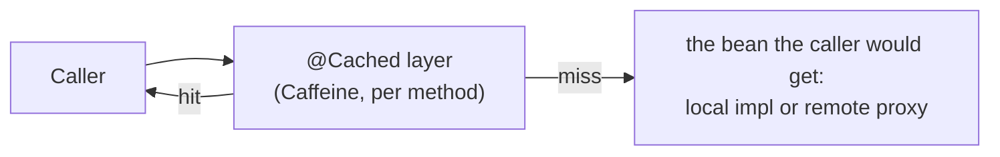

# Result cache: `@Cached`

Many of the 17 to 20 calls inside one order are reads of data that rarely changes: the same customer looked up five times, the same product looked up
by two modules. `@Cached` lets a read method opt in to having its result reused for a short time.

```java
@RpcApi("customers")
public interface CustomersApi {

    @Idempotent
    @Cached                                   // 30 seconds, 10,000 argument lists, per process
    Customer getCustomer(String customerId);
}
```

## How it works



* A Caffeine cache per annotated method, keyed by the argument list, with a time-to-live (`ttlSeconds`, default 30) and a size bound (`maxSize`, default 10,000).
* It sits in front of **every** `@RpcApi` bean: local implementations as well as `loopback` and `remote` proxies. A hit costs about the same
  (a few microseconds) wherever the module runs, so callers behave the same in every [mode](../modes/index.md).
* **Failures and `null` results are never cached.** A customer that does not exist yet is looked up again next time.
* When the RPC dispatcher serves a *remote* caller, the layer is skipped for that one call (the remote caller has its own cache); calls the implementation
  makes while serving it do use their own caches.
* In the call trace a hit appears as binding `cache`, so latency tables show hits separately from real calls.

## What is annotated

| Method | Why it is safe |
| --- | --- |
| `customers.getCustomer`, `customers.getPaymentMethod` | slowly changing reference data |
| `catalog.getProduct`, `catalog.productExists` | slowly changing reference data |

Deliberately **not** annotated: `inventory.getStock` and `getReservation` (they change constantly), every method that changes state, and
`pricing.quote` / `shipping.quote` (derived values, a possible later candidate).

## Switching it off

```bash
scripts/demo.sh groups start --cache off                    # or: rpc.cache.enabled=false (env RPC_CACHE_ENABLED=false)
scripts/perf.sh --modes groups --cache both                 # measure with it off and on
```

## What to watch for

!!! warning "Staleness"
    A change to a customer's tier or payment method is invisible to callers until the entry expires. Keep the time-to-live short, and annotate only
    data where that is acceptable.

!!! warning "Per-process caches"
    Each process has its own cache. With several instances of a service they can briefly disagree, and in the eight-process modes each service
    warms its own cache (hit rates are lower there; see [the measurements](../performance/switches.md#result-cache)).

!!! warning "Results are shared"
    The same object is handed to every caller, so result types must be immutable (the demo's are records).

Where it lives: `platform/rpc-api` (`Cached`, `CacheSignals`), `platform/rpc-spring-boot-starter` (`CachingBeanPostProcessor`); it is on `main`.
