# Parallel quotes

At the start of `orders.placeOrder` three calls are independent reads: check that the customer exists, price the lines, price the delivery.
Run one after the other, their latencies add up. Run together, the wait is the slowest of the three.

```mermaid
gantt
    dateFormat X
    axisFormat %s
    section Sequential
    customers.getCustomer :a1, 0, 1
    pricing.quote         :a2, 1, 5
    shipping.quote        :a3, 5, 11
    section Parallel
    customers.getCustomer :b1, 0, 1
    pricing.quote         :b2, 0, 4
    shipping.quote        :b3, 0, 6
```



(Illustrative durations in milliseconds.)

## How it works

```java
Parallel.Pending<Customer>      known   = Parallel.supply(() -> customers.getCustomer(customerId));
Parallel.Pending<Quote>         priced  = Parallel.supply(() -> pricing.quote(customerId, quoteLines));
Parallel.Pending<ShippingQuote> shipped = Parallel.supply(() -> shipping.quote(customerId, shipLines));
known.join();                        // joined in the order a sequential run would have thrown
Quote quote = priced.join();
ShippingQuote delivery = shipped.join();
```

* Each call runs on its own **virtual thread**.
* `join()` rethrows the failure *unwrapped*, and the joins happen in program order, so a caller sees the same exception it would have seen before.
* **Thread-bound context is carried into the worker**: the logging MDC (correlation id, trace id) and the demo call-trace depth, through registered
  propagators. Anything else thread-bound that matters to a call (a security context, a transaction) must be registered too, or not used inside a parallel call.
* It is for reads only. Calls that change state keep their explicit order, because the saga's compensation logic depends on it.

## Switching it off

```bash
MODULES_ORDERS_PARALLEL_QUOTES=false scripts/demo.sh microservices start     # or: modules.orders.parallel-quotes=false
scripts/perf.sh --modes microservices --parallel both
```

The sequential code is still there when it is off.

## Expectations

It removes waiting, not work, so it helps where calls are slow (a network hop) and does little where they are free (an in-process call).
[The measurements](../performance/switches.md#parallel-quotes) show exactly that. It does not make the machine do less: at saturation the gain shrinks.

Where it lives: `platform/rpc-api` (`Parallel`), `OrdersService`; it is on the branch `discuss/spring-modulith-async` and in `spike/switchable-async`.
