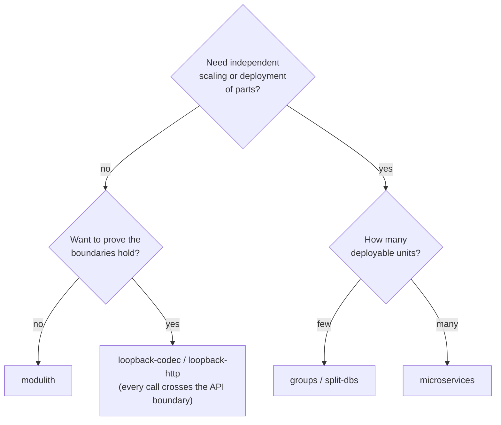

# The eight deployment modes

The same modules, the same API interfaces and the same tests run in eight shapes. Only the artifact that is started and its configuration change.
`scripts/demo.sh <mode> start` brings up PostgreSQL in a clean state and starts the mode.

| Mode | Processes | Artifact | Cross-module calls | Databases |
| --- | --- | --- | --- | --- |
| [`modulith`](single-process.md#modulith) | 1 | `app-modulith` | all `local` | one instance, eight schemas |
| [`macro-monolith`](single-process.md#macro-monolith) | 1 | `app-macro`, profile `monolith` | all `local` | one instance |
| [`loopback-codec`](single-process.md#loopback-codec) | 1 | `app-macro`, profile `loopback-codec` | all through the JSON codec, in memory | one instance |
| [`loopback-http`](single-process.md#loopback-http) | 1 | `app-macro`, profile `loopback-http` | all over HTTP to itself | one instance |
| [`groups`](split.md#groups) | 3 | `app-macro`, profiles `front`, `fulfilment`, `accounts` | `local` inside a group, `remote` between groups | one instance |
| [`split-dbs`](split.md#split-dbs) | 3 | as `groups` | as `groups` | **three** instances, one per group |
| [`microservices`](split.md#microservices) | 8 | eight `app-<module>-service` jars | all `remote` | one instance |
| [`microservices-macro`](split.md#microservices-macro) | 8 | `app-macro` eight times, profile = module | all `remote` | one instance |

All of them serve the orders entry point and the demo shop on **port 9181**, so a client or a load test is pointed at the same URL in every mode.

## Picking one

| You want to know... | Use |
| --- | --- |
| The cheapest possible shape, no boundary overhead | `modulith` |
| Whether the code still works when every call is serialised (no shared objects, no shared transactions) | `loopback-codec` |
| What a real HTTP hop costs without a second process | `loopback-http` |
| The middle ground: a few deployable units, local calls inside each | `groups` |
| Whether a group can move to its own database server | `split-dbs` |
| The full microservice shape, one jar per service | `microservices` |
| The same shape built from the single macro jar | `microservices-macro` |

!!! tip "The same checks run in every mode"
    `scripts/smoke.sh` runs seven scenarios (happy path, tier discount, out of stock, payment declined, shipping failure, a dependency being
    down, an idempotent retry) against whichever mode is running and asserts the results, the exception types and the binding on every edge.
    `scripts/demo-all.sh` runs it against all eight on a clean database.

## Ports

| Item | Port |
| --- | --- |
| Orders entry point and shop (every mode) | 9181 |
| `groups`, `split-dbs` | 9181 `front`, 9182 `fulfilment`, 9183 `accounts` |
| `microservices`, `microservices-macro` | 9181 orders, 9182 catalog, 9183 pricing, 9184 inventory, 9185 customers, 9186 payments, 9187 shipping, 9188 notifications |
| PostgreSQL | 5432 (A), 5433 (B), 5434 (C; B and C only in `split-dbs`) |

What each shape *costs* is measured in the [performance section](../performance/modes.md).
