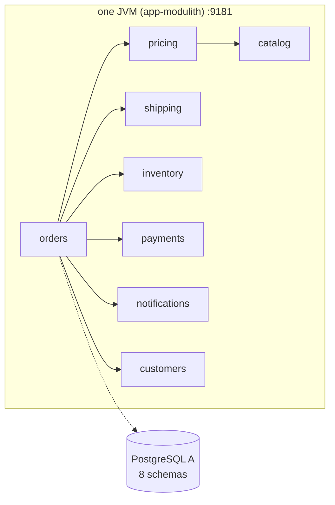
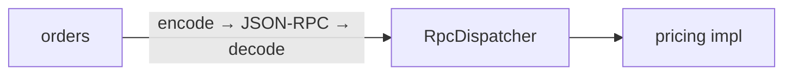

# Modes that run in one process

Four shapes, one JVM. They differ in *how* the module boundary is crossed, which makes them a clean way to price each layer: a method call, a
serialisation, an HTTP request.

## modulith

* **Run:** `scripts/demo.sh modulith start`
* **What it is:** the fixed all-in-one assembly. `app-modulith` refuses to start if any module is disabled or bound to anything but `local`.
* **Calls:** direct method calls through the `@RpcApi` interface; no serialisation.
* **Databases:** eight schemas on one PostgreSQL instance, each with its own roles and its own connection pool.
* **Use it for:** the lowest-cost baseline, and day-to-day development.

## macro-monolith

* **Run:** `scripts/demo.sh macro-monolith start`
* **What it is:** the *configurable* jar (`app-macro`) with the `monolith` profile, which enables every module as `local`.
* **Why it exists:** it proves that the macro jar, which can become any other shape, behaves the same as the fixed assembly when it is configured as a monolith.
  Its numbers should match `modulith`; they do (see [the measurements](../performance/modes.md)).

## loopback-codec

* **Run:** `scripts/demo.sh loopback-codec start`
* **What it is:** every cross-module call is turned into a JSON-RPC request, dispatched in memory and the answer decoded, but never leaves the JVM.
* **Why it exists:** it finds the bugs that a local call hides: code that relies on shared mutable objects, on classes that do not serialise,
  or on a transaction that the callee silently joined. If a scenario works here, no object identity or shared transaction is being smuggled
  across a boundary.
* **Not allowed in production:** the registrar rejects loopback bindings under a `prod`/`production` profile.

## loopback-http

* **Run:** `scripts/demo.sh loopback-http start`
* **What it is:** every cross-module call is a real HTTP request to `127.0.0.1:9181`, served by the same process.
* **Why it exists:** it isolates the cost and behaviour of HTTP (connection handling, timeouts, error mapping, retries of `@Idempotent`
  methods) from the cost of a second process. It is the nearest thing to a microservice shape that still starts in one JVM.
* **Watch for:** the process calls itself, so the HTTP server threads are shared between the entry point and the callbacks.

!!! note "The cache applies in every binding"
    The `@Cached` layer sits in front of local, loopback and remote beans alike, so a cache hit costs about the same in all four. See
    [the cache](../features/cache.md).
