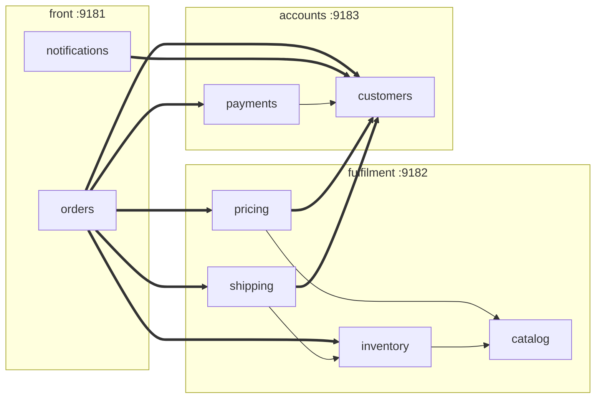
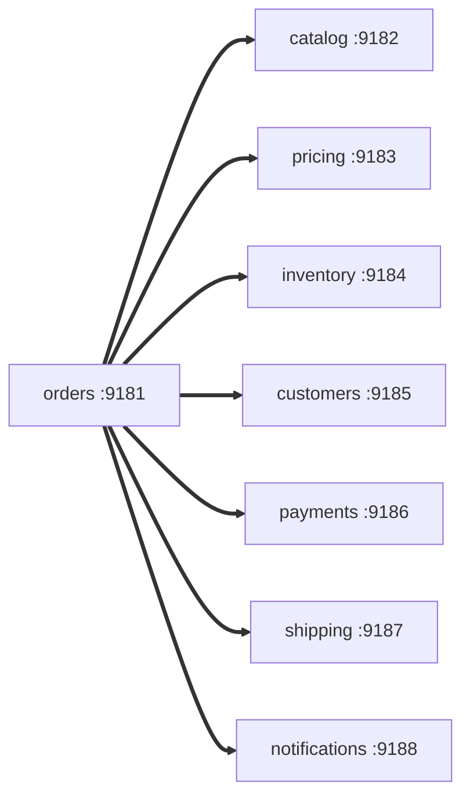

# Modes that split the system across processes

## groups

Thick arrows cross a process boundary (JSON-RPC over HTTP); thin ones are direct calls inside a group.

* **Run:** `scripts/demo.sh groups start`
* **What it is:** the macro jar started three times with the profiles `front`, `fulfilment` and `accounts`. A group is just a set of enabled modules plus URLs for the rest.
* **Why it exists:** most real systems land here: a few deployable units, with the chatty chains (`pricing → catalog`, `shipping → inventory → catalog`) kept inside one process.
* **Design rule:** the graph *between groups* must also be acyclic, or start-up and readiness get fragile. `front → fulfilment → accounts` is.

## split-dbs

* **Run:** `scripts/demo.sh split-dbs start`
* **What it is:** `groups`, with each group on its own PostgreSQL instance: `front` on A (5432), `fulfilment` on B (5433), `accounts` on C (5434).
* **Why it exists:** it shows that moving a group to another database server is configuration (`modules.<m>.datasource.url`), not code. Each module
  still sees only its own schema.

## microservices

(Only orders' edges are drawn; every other edge is also a remote call.)

* **Run:** `scripts/demo.sh microservices start`
* **What it is:** eight separate jars, `app-<module>-service`, generated from one template (`scripts/new-service-app.sh`). Each contains only its own
  implementation plus the `-api` artifacts of the modules it calls, which an enforcer rule checks.
* **Why it exists:** it is the conventional microservice shape, so every comparison has an honest reference point.
* **Cost:** eight JVMs and every one of the 17 to 20 calls per order is a network hop.

## microservices-macro

* **Run:** `scripts/demo.sh microservices-macro start`
* **What it is:** the *same* eight-process shape, but built from the single macro jar run eight times, with the profile named after the module that process hosts.
* **Why it exists:** one artifact to build, test and ship, deployed as eight services, which is the central claim of the project. Its measurements
  match `microservices`, which shows the single artifact costs nothing extra at runtime.

!!! warning "Resource use"
    The eight-process modes start eight JVMs (about 320 MB of heap each by default). On a laptop, `microservices` and `microservices-macro`
    are the heavy ones; `DEMO_JAVA_OPTS` overrides the JVM options.

How the split shapes compare under load is in [the measurements](../performance/modes.md).
